# Photo map

Generated from `src/content/photo-map.ts` by `node scripts/photo-docs.ts` — edit the TS file, not this table.

**38 photos inventoried** (19 from `photos/`, 19 downloaded from the restaurant's own listings) ·
**26 processed** for the site · confidence: **26 high**, 9 medium, 3 low.
No photo of the printed menu was found in `photos/`, so the seed menu (Deliveroo / Privateaser / eatbu) stands.

Low-confidence rows come first. "Used" = processed into `public/images` (AVIF + WebP, 480/960/1600/2400 capped at source width, focal-crop square thumb, LQIP, EXIF/GPS stripped, house grade).

| | id | confidence | kind | menu items | usage | used | source | notes / original |
|---|---|---|---|---|---|---|---|---|
| 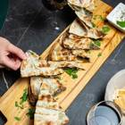 | `arayes` | low | dish | — | — | — | folder | Pain grillé farci de viande (arayes ? sandwich lahmé ?). Absent de la carte : à identifier avec Jalal.  SnapInsta.to_662347168_17967204249021456_6426015338669424793_n.jpg |
| 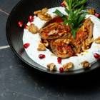 | `aubergine-labneh` | low | dish | — | — | — | folder | Aubergines braisées farcies (poivron, noix) sur couronne de labneh, grenade, estragon. Pas sur la carte seed — ce n'est pas le foie de volaille. À identifier.  SnapInsta.to_730325795_17977090692021456_1530746409676867752_n.jpg |
| 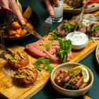 | `table-crus` | low | table-ambiance | `makanek`, `batata-harra` | — | — | folder | Viande crue (kebbé nayé / kafta nayé ?) et makanek. Plats crus absents de la carte : à confirmer.  SnapInsta.to_721099347_17975191008021456_339258876315328471_n.jpg |
| 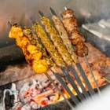 | `grillades-feu` | medium | dish | `grillade-mixte` | menu, gallery | ✓ | online | Galerie eatbu, légende « Grillades ». Brochettes (taouk, kafta, agneau) sur la braise.  eatbu-grillades.jpg |
| 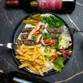 | `kafta-assiette` | medium | dish | `kafta` | — | — | folder | Assiette de kafta, frites, salade, deux bouteilles de vin libanais (étiquette tierce visible). Assiette Kafta probable.  SnapInsta.to_846156754_17993106453021456_5566133176502304413_n.jpg |
| 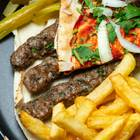 | `kafta-maison-l` | medium | dish | `kafta-maison-l`, `kafta` | signature, menu | ✓ | folder | Trois kafta sur pain, pain nappé de sauce rouge (tomate ?), oignon, persil, frites. Kafta Maison L probable ; pourrait être la kafta classique.  SnapInsta.to_757546372_17982179772021456_1438921809675704198_n.jpg |
| 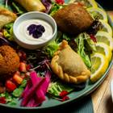 | `planche-beignets` | medium | dish | `assortiment-mezzes-chef` | menu | ✓ | online | Galerie eatbu, légende « Planche de beignets » (kebbé, falafel, samboussek, rakakat). Rattaché à l'assortiment du chef — à confirmer.  eatbu-planche-beignets.jpg |
| 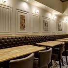 | `salle-banquette` | medium | interior | — | — | — | online | Banquette capitonnée, portraits encadrés, carreaux de ciment. Décor absent de la vidéo : 2e salle ? À confirmer.  privateaser-486201.jpg |
| 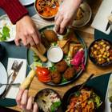 | `table-mezzes` | medium | table-ambiance | `assortiment-mezzes-chef`, `mouhammara`, `moutabal`, `labneh`, `fattouche`, `moussabbaha` | gallery | ✓ | folder | Plateau central (falafel, kebbé, fatayer, rakakat, navets) entouré de mezzés. Mains seulement.  SnapInsta.to_683646073_17970636390021456_5967326837368539236_n.jpg |
| 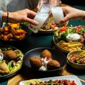 | `table-toast` | medium | table-ambiance | `kebbe-viande`, `makanek`, `batata-harra`, `grillade-mixte` | gallery | ✓ | folder | Trinquer (boisson blanche trouble, arak ?) au-dessus des mezzés. Pas de visage.  SnapInsta.to_621363172_17992582901916433_8088315817527390625_n.jpg |
| 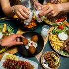 | `table-toast-2` | medium | table-ambiance | `kebbe-viande`, `makanek`, `batata-harra`, `kafta` | — | — | folder | Quasi-doublon de table-toast. Bas du visage d'une cliente coupé au menton — écarté par prudence.  SnapInsta.to_741395577_17979596316021456_2336040009957520479_n.jpg |
| 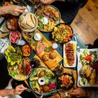 | `table-zenith` | medium | table-ambiance | `houmous-betterave`, `mouhammara`, `taboule`, `makanek`, `fattouche`, `grillade-mixte` | gallery, og | ✓ | folder | Table entière vue du dessus, mains seulement. Plat rose cru (kebbé nayé ?) absent de la carte. Image de partage forte.  SnapInsta.to_622395411_18007840907832688_2166939907781884861_n.jpg |
| 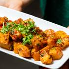 | `batata-harra` | high | dish | `batata-harra` | menu | ✓ | folder | Pommes de terre sautées, coriandre, piment. Main visible (pas de visage).  SnapInsta.to_649665496_17963708361021456_9097353563841847208_n.jpg |
| 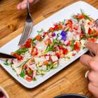 | `chankliche` | high | dish | `chankliche` | menu | ✓ | online | Galerie eatbu, légende « Chankliche ».  eatbu-chankliche.jpg |
| 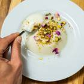 | `dup-eatbu-mouhalabiyeh` | high | dish | `mouhalabiyeh` | — | — | online | Doublon : photo du dossier préférée.  eatbu-mouhalabiyeh.jpg |
| 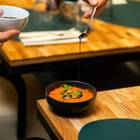 | `dup-eatbu-mouhammara` | high | dish | `mouhammara` | — | — | online | Doublon : photo du dossier préférée.  eatbu-mouhammara.jpg |
| 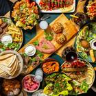 | `dup-eatbu-principale` | high | table-ambiance | — | — | — | online | Image principale eatbu = recadrage 2:1 de table-zenith (dossier).  eatbu-image-principale.jpg |
|  | `dup-eatbu-principale-b` | high | table-ambiance | — | — | — | online | Même image que dup-eatbu-principale, autre taille.  eatbu-image-principale-b.jpg |
| 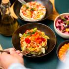 | `dup-eatbu-salade-du-moine` | high | dish | `salade-du-moine` | — | — | online | Doublon : photo du dossier préférée.  eatbu-salade-du-moine.jpg |
|  | `dup-eatbu-warak-enab` | high | dish | `warak-enab` | — | — | online | Doublon : photo du dossier préférée.  eatbu-warak-enab.jpg |
|  | `facade` | high | exterior | — | gallery | ✓ | online | Façade de nuit, enseigne lumineuse, terrasse. Graffiti à gauche : recadrer à droite.  privateaser-486208.jpg |
| 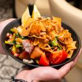 | `fattouche` | high | dish | `fattouche` | menu | ✓ | online | Galerie eatbu, légende « Fattouche ».  eatbu-fattouche.jpg |
| 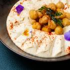 | `houmous` | high | dish | `houmous` | menu | ✓ | online | Galerie eatbu, légende « Hommous ».  eatbu-houmous.jpg |
| 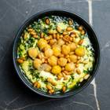 | `houmous-basilic` | high | dish | `houmous-basilic` | menu | ✓ | folder | Vue zénithale, sauce basilic verte, pignons et pois chiches. Marbre noir. Excellente.  SnapInsta.to_642315768_17963179761021456_7309337162889068713_n.jpg |
| 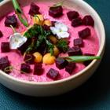 | `houmous-betterave` | high | dish | `houmous-betterave` | signature, menu | ✓ | online | Galerie eatbu, légende « Hommous betterave ». Rose vif, betterave en dés, fleurs.  eatbu-houmous-betterave.jpg |
| 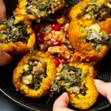 | `kebbe-citrouille` | high | dish | `kebbe-citrouille` | signature, menu | ✓ | folder | Croûte orangée de citrouille, farce blettes et pois chiches, grenade. Gros plan net.  SnapInsta.to_657346403_17965513452021456_3724981782388531710_n.jpg |
| 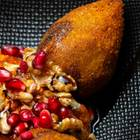 | `kebbe-viande` | high | dish | `kebbe-viande` | menu | ✓ | folder | Kebbé en fuseau, noix, grenade, mélasse. Macro très nette.  SnapInsta.to_772534961_17984213013021456_2530090621888586836_n.jpg |
| 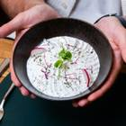 | `labneh` | high | dish | `labneh` | menu | ✓ | online | Galerie eatbu, légende « Labneh ».  eatbu-labneh.jpg |
| 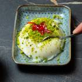 | `mouhalabiyeh` | high | dish | `mouhalabiyeh` | menu | ✓ | folder | Flan blanc en dôme, pistache, pétale confit. Concorde avec la photo « Mouhalabiyeh » de la galerie eatbu.  SnapInsta.to_730941263_17978165406021456_4780592653437362920_n.jpg |
| 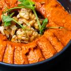 | `mouhammara` | high | dish | `mouhammara` | signature, menu | ✓ | folder | Purée rouge en couronne, cerneaux de noix, pousses. Excellente.  SnapInsta.to_779145746_17986335657021456_4336820901636779616_n.jpg |
| 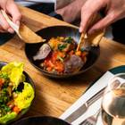 | `moussaka` | high | dish | `moussaka-libanaise` | menu | ✓ | online | Galerie eatbu, légende « Moussaka ».  eatbu-moussaka.jpg |
| 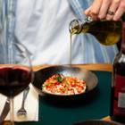 | `moutabal` | high | dish | `moutabal` | menu | ✓ | online | Galerie eatbu, légende « Moutabal ». Filet d'huile d'olive versé.  eatbu-moutabal.jpg |
| 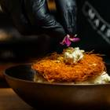 | `osmalliyeh` | high | dish | `osmalliyeh` | signature, menu | ✓ | online | Galerie eatbu, légende « Osmalliyeh ». Main gantée qui dresse un pétale, fond sombre. Superbe.  eatbu-osmalliyeh.jpg |
| 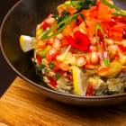 | `salade-du-moine` | high | dish | `salade-du-moine` | menu | ✓ | folder | Aubergine grillée, poivrons, grenade, citron — dressage en cercle.  SnapInsta.to_731651637_17978606742021456_4305207413712642900_n.jpg |
| 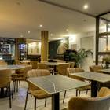 | `salle` | high | interior | — | intro, hero-poster | ✓ | online | Salle principale, bar au fond, fauteuils camel, tables en céramique noire. Même salle que la vidéo.  privateaser-486207.jpg |
| 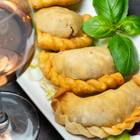 | `samboussek` | high | dish | `samboussek-viande` | menu | ✓ | folder | Chaussons en demi-lune au bord torsadé, basilic, verre de rosé.  SnapInsta.to_702968426_17972388894021456_5322139657961769045_n.jpg |
| 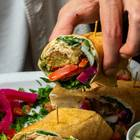 | `sandwich-falafel` | high | dish | `sandwich-falafel` | menu | ✓ | folder | Wrap falafel coupé, tomate, navet, persil. Pour le bloc À emporter.  SnapInsta.to_820024598_17990209917021456_2200439868907965787_n.jpg |
| 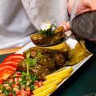 | `warak-enab` | high | dish | `warak-enab` | menu | ✓ | folder | Feuilles de vigne roulées, grenade, citron. Arrière-plan clair (chemise) un peu présent.  SnapInsta.to_748115207_17980162311021456_3401400974063521680_n.jpg |
